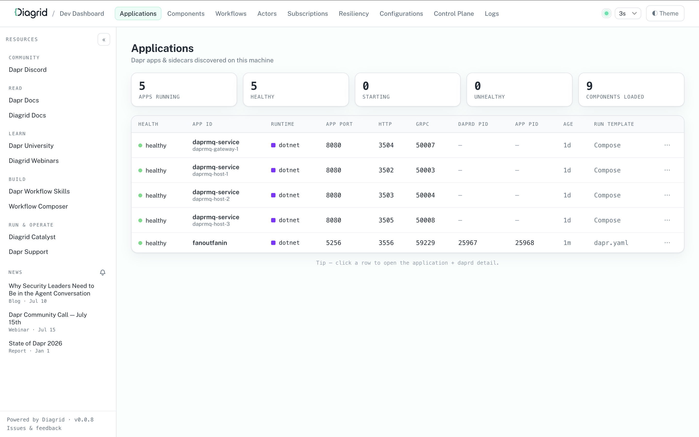
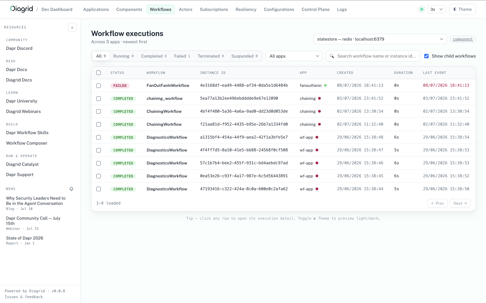
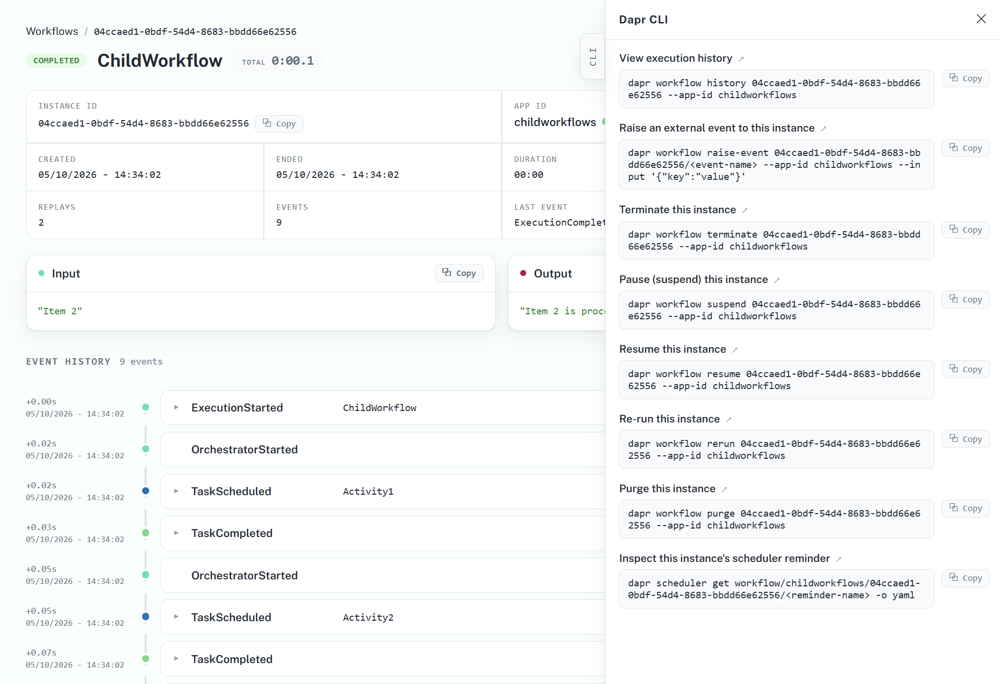
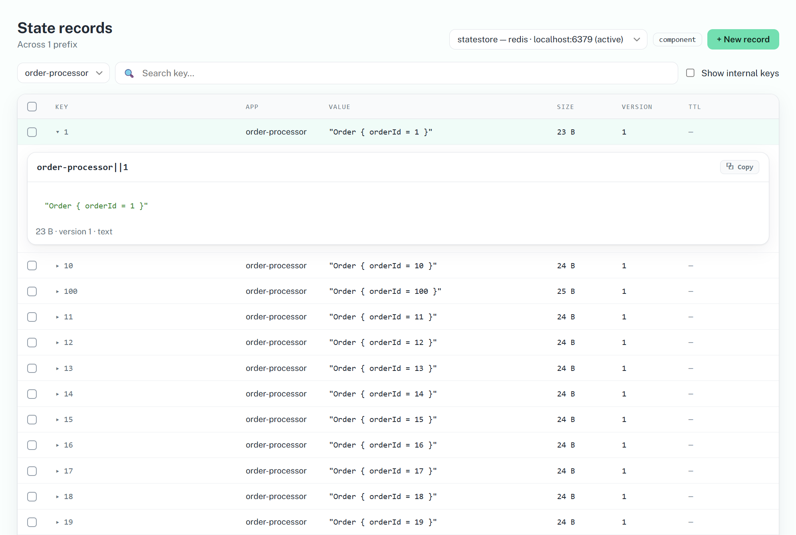
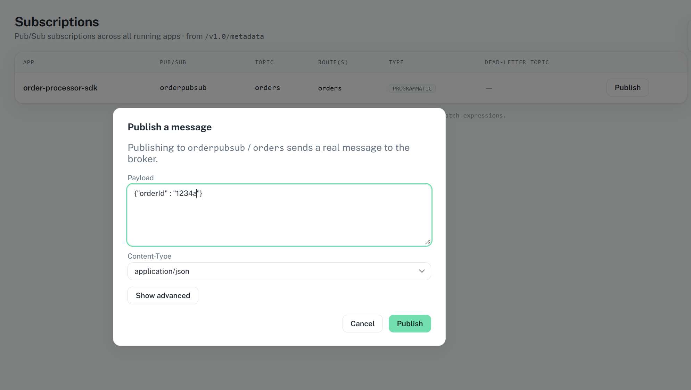

# Diagrid Dapr Dev Dashboard

A local dashboard for Dapr developers that offers a live view of everything Dapr running on
your machine, plus guided builders for authoring Dapr component and resiliency YAML.





## Goal

The Diagrid Dapr Dev Dashboard is a companion for local Dapr development. It inspects the
apps you start with `dapr run` / `dapr run -f`, Aspire, Docker Compose, or Dapr
Testcontainers (e.g. Spring Boot apps run with `mvn spring-boot:test-run` and
`dapr-spring-boot-starter-test`), and surfaces everything about them — sidecars, workflows,
actors, subscriptions, components, resiliency policies, configurations, and logs.

It also helps you author Dapr resources. The **Component Builder** walks you through
picking a component type from the full Dapr catalog, filling in its metadata fields, and
choosing an authentication profile; the **Resiliency Builder** composes resiliency policies
(timeouts, retries, circuit breakers) and applies them to targets (apps, actors, components).
Both wizards end in a YAML preview you can copy or download into your project.

## Installation instructions

The dashboard ships as a standalone binary published on GitHub Releases.

**Install (one-liner):**

*macOS / Linux — installs to ~/.local/bin*

```sh
curl -sSL https://raw.githubusercontent.com/diagridio/dev-dashboard/main/scripts/install.sh | sh
```

*Windows (PowerShell) — installs to %LOCALAPPDATA%\Programs\diagrid-dev-dashboard*

```powershell
iwr -useb https://raw.githubusercontent.com/diagridio/dev-dashboard/main/scripts/install.ps1 | iex
```

**To pin a specific version, set `VERSION` before piping:**

*macOS / Linux*

```sh
curl -sSL https://raw.githubusercontent.com/diagridio/dev-dashboard/main/scripts/install.sh | VERSION=vX.Y.Z sh
```

*Windows*

```powershell
$env:VERSION='vX.Y.Z'; iwr -useb https://raw.githubusercontent.com/diagridio/dev-dashboard/main/scripts/install.ps1 | iex
```

If the install directory is not on your `PATH`, the script prints the export line to add.

**Install with Go (≥ 1.26):**

```sh
go install github.com/diagridio/dev-dashboard@latest
```

> **Note:** `go install` names the binary after the module path, so it produces
> `dev-dashboard`, not `diagrid-dev-dashboard` — rename it afterwards
> (`mv "$(go env GOPATH)/bin/dev-dashboard" "$(go env GOPATH)/bin/diagrid-dev-dashboard"`)
> or use the install script above.

**Manual download:**

Download the archive for your platform from the [GitHub Releases](https://github.com/diagridio/dev-dashboard/releases) page, extract it, and place `diagrid-dev-dashboard` (or `diagrid-dev-dashboard.exe`) on your `PATH`. Verify with:

```sh
diagrid-dev-dashboard --version
```

## Run the dashboard

```sh
# Start on the default port (9090) and open your browser automatically
diagrid-dev-dashboard
```

```sh
# Start on a custom port
diagrid-dev-dashboard --port 8080
```

```sh
# Enable diagnostic logging to stderr (server startup, app discovery, state-store connection, log streams, workflow operations)
diagrid-dev-dashboard --verbose
```

No additional setup is needed: the dashboard discovers running Dapr apps the same way
`dapr list` does, so anything started with `dapr run` / `dapr run -f`, Aspire, Docker
Compose, or Dapr Testcontainers shows up within one refresh cycle. Testcontainers apps
(e.g. a Spring Boot app under `mvn spring-boot:test-run`) need zero configuration: the
dashboard finds the Testcontainers-managed daprd container, pairs it with your host app
process, and even reads workflows from an in-memory state store via the sidecar itself.

> **Tip:** once the dashboard is open, try the Konami code (↑ ↑ ↓ ↓ ← → ← → B A) and have
> some fun! ;)

With `--mode`/`DEVDASHBOARD_MODE` unset (the default for host use), the dashboard performs the
complete scan across all discovery sources described above. Setting a mode restricts every
dashboard surface — applications, workflows, state stores, the Control Plane view, and log
targets — to a single source; filters are exclusive and never combined:

- `--mode dapr-run` — host `dapr run` processes only (Control Plane shows the `dapr init` containers).
- `--mode compose` — Docker Compose containers only (Control Plane shows compose-run placement/scheduler).
- `--mode test-containers` — Testcontainers discovery only (no control-plane detection yet).
- `--mode aspire` — Aspire resources only. Inside an AppHost-managed container (the
  `DEVDASHBOARD_APP_*` contract is present) this is the container serving posture described
  below; on a plain host it filters the process scan to Aspire-managed apps.

`compose` and `test-containers` require a container runtime (docker or podman) and fail at
startup without one. `--bind` (default `127.0.0.1`, `0.0.0.0` in aspire container posture)
controls the listen address alongside `--port`.

## Run as a container (.NET Aspire)

The dashboard also ships as a container image, purpose-built for embedding inside a
[.NET Aspire](https://learn.microsoft.com/dotnet/aspire/) AppHost via the
[`diagrid-labs/dashboard-aspire`](https://github.com/diagrid-labs/dashboard-aspire) hosting
integration (which will be rewritten against the contract below). It also runs standalone
with a hand-written `docker run`.

**Image:** `ghcr.io/diagridio/dev-dashboard`, tagged `:X.Y.Z` (in lockstep with binary
releases) and `:latest`. Prerelease tags (e.g. `v1.5.0-rc.1`) publish their own version tag
but do not move `:latest`. The image bakes in `DEVDASHBOARD_MODE=aspire` and serves on port
`8080` bound to `0.0.0.0`.

In aspire mode, discovery is restricted to the env contract below (no host process scan, no
Docker Compose scan), and the following are disabled: app lifecycle controls
(start/stop/restart), the control-plane page, log tailing, self-update/update-check, and
automatic browser opening.

**Try it:**

```bash
docker run --rm -p 8080:8080 \
  -e DEVDASHBOARD_APP_COUNT=1 \
  -e DEVDASHBOARD_APP_0_ID=myapp \
  -e DEVDASHBOARD_APP_0_DAPR_HTTP=http://host.docker.internal:3500 \
  ghcr.io/diagridio/dev-dashboard:latest
```

**Mode switch:**

| Source | Values | Default |
|---|---|---|
| `--mode` flag / `DEVDASHBOARD_MODE` env | `dapr-run`, `compose`, `test-containers`, `aspire` | unset (complete scan) |

**App discovery** — one set of `_<i>_*` vars per app, for `i = 0..DEVDASHBOARD_APP_COUNT-1`:

| Env var | Required | Meaning |
|---|---|---|
| `DEVDASHBOARD_APP_COUNT` | yes | number of apps (`0` is valid: empty dashboard) |
| `DEVDASHBOARD_APP_<i>_ID` | yes | Dapr app-id |
| `DEVDASHBOARD_APP_<i>_DAPR_HTTP` | yes | daprd HTTP base URL, reachable **from the dashboard container** (e.g. `http://myapp-dapr:3500`) |
| `DEVDASHBOARD_APP_<i>_NAMESPACE` | no | per-app Dapr namespace; defaults to `DEVDASHBOARD_NAMESPACE`. Used for **app-scoped** workflow operations — fetching one instance's history, an app-filtered workflow list/stats, and force delete — so those honor the app's own namespace. The store-wide workflow list, stats, and app-id dropdown (all-apps scans) still use the global `DEVDASHBOARD_NAMESPACE` |
| `DEVDASHBOARD_APP_<i>_LABEL` | no | display name; defaults to the app-id. Shown in the applications list and app detail header whenever it differs from the app-id |

Validation is fail-fast at startup: a missing or non-numeric `DEVDASHBOARD_APP_COUNT`, any
missing required per-app var, or an unparsable `DAPR_HTTP` URL exits with an error naming the
exact variable.

**Security note:** in aspire mode the dashboard drops the loopback `Host` check (the container
is addressed by its Docker-network name or a published port). Without `DEVDASHBOARD_ALLOWED_HOSTS`
it accepts any `Host`, which means a malicious web page using DNS rebinding can reach the API even
when the port is published only to `localhost`. Setting `DEVDASHBOARD_ALLOWED_HOSTS` to the
hostnames the dashboard is served under closes that hole (loopback names are always allowed).
Mutating requests are still protected by a normalized same-origin check. The dashboard is a local
development tool — never expose it publicly.

**Serving and features:**

| Env var / flag | Default (aspire) | Meaning |
|---|---|---|
| `DEVDASHBOARD_PORT` / `--port` | `8080` | listen port |
| `DEVDASHBOARD_BIND` / `--bind` | `0.0.0.0` | bind address |
| `DEVDASHBOARD_STATESTORE_FILE` / `--statestore` | unset | path to a mounted Dapr state-store component YAML; enables the Workflows page |
| `DEVDASHBOARD_NAMESPACE` / `--namespace` | `default` | default Dapr namespace for workflow actor keys |
| `DEVDASHBOARD_RESOURCES_PATH` | dir of `DEVDASHBOARD_STATESTORE_FILE` | extra component directories for the Resources page, `os.PathListSeparator`-separated |
| `DEVDASHBOARD_ALLOWED_HOSTS` | unset (any host) | optional, aspire mode only; comma-separated hostnames the `Host` header is restricted to (loopback always allowed). Empty means any host. Set it to close the DNS-rebinding hole described above |
| `DEVDASHBOARD_MODE` | `aspire` (baked into the image) | see mode switch above |

Precedence everywhere is **flag > env > posture default**.

## Updating the dashboard

On startup the dashboard checks GitHub for a newer release. If one exists, it prints
a notice as the first line of output and the web UI shows an **Update available**
indicator next to the version number in the Resources panel. The check is best-effort:
it is skipped for source/dev builds and fails silently when offline.

Update to the latest release (no-op if already current)

```sh
diagrid-dev-dashboard update
```

Install a specific version (can downgrade or reinstall)

```sh
diagrid-dev-dashboard update 1.2.0
```

`update` downloads the release archive for your platform, verifies its SHA256
against the release `checksums.txt`, and atomically replaces the running binary.
Restart any running dashboard to use the new version.

## Troubleshooting

If the dashboard does not behave as expected, run it with `--verbose` to print diagnostic logs to stderr:

```sh
diagrid-dev-dashboard --verbose
```

Logs are grouped by `component=` (values: `server`, `discovery`, `workflow`, `registry`, `reconciler`) and use levels INFO (normal milestones), WARN (degraded but still working, e.g. a state store that failed to initialise), and ERROR (an operation failed, e.g. the server could not bind its port). Without `--verbose`, no diagnostic logs are emitted.

## Use cases

Developers use the dashboard to observe and debug Dapr apps while building locally:

- **See what's running** — a live table of all running apps/sidecars: app id, health,
  runtime/language, app/HTTP/gRPC ports, daprd + app PIDs, age, and owning run process.
  Apps that have fully stopped can be removed from the list one by one or all at once with
  **Clear inactive**. This only hides them from the dashboard; no containers or files are
  deleted, and an app that starts running again reappears.
- **Inspect an application** — drill into a single app for its ports, PIDs, command,
  resource/config paths, runtime metadata, enabled features, and loaded components. Stop
  works for every discovery mode; Start and Restart are offered for Docker Compose apps only.
- **Debug workflows** — browse workflow executions across all apps with status filters and
  search, then open a run to watch its **live event history**, input/output, custom status,
  and a continuously-ticking wall-clock while it runs.
- **Clean up workflows** — terminate and/or purge individual or bulk workflows, with an
  explicit "force delete" fallback for stuck/orphaned state.
- **Browse, add & clean state records** — the **State** page lists the records in any connected
  state store: key, app prefix, value preview, size, version (etag), and TTL, paginated over the
  backend's own key cursor, with row expansion for the full value and a *Decode base64* toggle for
  encoded values. **+ New record** writes a record under `<app-id>||<key>` — the same key shape
  Dapr writes — and refuses a key that already exists unless you opt into overwriting; records can
  be deleted individually or by multi-select. There is no in-place edit: overwrite the key instead.
  Two limitations worth knowing:
  **workflow history and actor state are hidden by default** (they live in the same keyspace
  as your app's records — use *Show internal keys* to reveal them), and **there is no
  "last modified" column** — Dapr's state components do not expose a modification timestamp,
  so none can be shown. The Version column is the backend's etag: it changes on every write,
  but it is not a time. Stores that cannot be opened directly — an in-memory store inside a
  Testcontainers app, for example — cannot be browsed at all: Dapr's state API has no way to
  enumerate keys, so there is nothing to page over.
- **Review actors & subscriptions** — global pages aggregating active actor types and pub/sub
  subscriptions across all apps, each linkable back to the owning application. The
  Subscriptions page shows each subscription's type (declarative, programmatic, streaming) and
  expands multi-rule subscriptions to show every match expression and its route.
- **Publish a test message** — every subscription row has a **Publish** button that sends a
  real message to its pub/sub topic through the app's sidecar, with a payload editor, a
  content-type selector, and advanced options (`ttlInSeconds`, `rawPayload`).
- **Copy the matching Dapr CLI command** — a **CLI** drawer on the right edge of the page lists
  the self-hosted Dapr CLI commands that fit the current page, already filled in with the app
  ID and workflow instance ID you're looking at.
- **Read components & configurations** — read-only YAML viewers, enriched with which apps
  loaded each component; components that only exist inside a Testcontainers daprd container
  are extracted and shown too, with a container-prefixed path. A component's `secretKeyRef`
  and `envRef` values are resolved against your local secret stores (`local.file`,
  `local.env`), and each reference shows whether it resolved, and if not, which env var or
  file path was tried.
- **Build component YAML** — a guided wizard over the full Dapr component catalog: pick a
  type, fill in its metadata fields (with per-field docs and defaults), choose an
  authentication profile, then copy or download the generated YAML.
- **Build resiliency policies** — compose named timeouts, retries, and circuit breakers,
  apply them to targets (apps, actors, components), and export the resiliency spec as YAML.
- **Manage workflow state-store connections** — on the Components page, a recent-connections panel
  (with component file paths) lets you add, edit, and disconnect the state stores the dashboard
  reads workflows from. Auto-detected stores appear automatically; disconnecting one is durable —
  it stays hidden across restarts unless it becomes the active store again. The store workflows
  are currently read from can't be removed. Manual connections are saved to
  `~/.dapr/dev-dashboard/connections.yaml` (mode `0600`). When more than one store is known, a
  selector on the Workflows page lets you switch which one you browse.
- **Tail logs** — per-app daprd + app logs streamed live (SSE) with level coloring, keyword
  highlight, and a follow toggle.

The UI is built for fast scanning and debugging: deep-linkable views, a global autorefresh
control that doubles as a backend-connection indicator (data polling pauses while the
backend is unreachable and resumes on recovery), full keyboard operability, and
cross-navigation between related entities (app →
component → "loaded by" app, etc.).

### CLI drawer

Open the **CLI** tab on the right edge of the page to see the Dapr CLI commands for what
you're looking at. On a workflow instance, for example, it lists the commands to view the
history, raise an event, terminate, suspend, resume, re-run, or purge that instance, and to
inspect its scheduler reminder. Each command has a link to its docs and a **Copy** button.
The drawer shows on the Applications, Application detail, Workflows, Workflow detail, Actors,
and Subscriptions pages. Only self-hosted commands are listed; Kubernetes-only (`-k`) commands
are left out.



### State records

The **State** page lists the key/value records in a connected state store. Filter by app
prefix, search by key, and expand a row to see the full value with its size, version, and
encoding. Workflow and actor state is hidden unless you tick *Show internal keys*.
**+ New record** adds a record, and records can be deleted one at a time or by multi-select.



### Publish a message

On the **Subscriptions** page, **Publish** opens a dialog that sends a message to that
subscription's pub/sub component and topic. Enter the payload, pick a content type, and
optionally set `ttlInSeconds` or `rawPayload` under *Show advanced*. The message goes through
the app's sidecar to the real broker, so the subscriber receives it like any other message.
The button is disabled when the sidecar is unreachable, and errors from daprd are shown as-is.



## Non-Goals

The dashboard is a **local development tool**, and only that:

- **Not for Kubernetes.** It is not intended to run inside a Kubernetes cluster. It discovers
  apps the way `dapr list` does — from the local process table and local container runtime —
  which has no meaning in-cluster.
- **Not for production.** It is not intended for production, staging, or any shared/hosted
  environment. It has no authentication, authorization, or multi-user model, and it reads
  local files and state stores with the privileges of the user who runs it.
- **Not a control plane or deployment tool.** It observes and helps you author YAML locally;
  it does not deploy apps or manage remote Dapr installations.

Run it on your own machine, alongside the apps you start with `dapr run`, Aspire, Docker
Compose, or Dapr Testcontainers.

## Architecture

The dashboard is a **single Go binary** with an embedded React SPA. It discovers running
apps the same way `dapr list` does (plus Docker Compose, Testcontainers, and Aspire),
enriches them from each sidecar's `/v1.0/metadata` and `/v1.0/healthz` endpoints, and reads
workflows from your state store (Redis, PostgreSQL, SQLite, or MongoDB), or live from the
sidecar's gRPC workflow API (Dapr ≥ 1.17) when the store can't be opened.

See [ARCHITECTURE.md](ARCHITECTURE.md) for how discovery, state-store election, the HTTP
layer, and the SPA fit together, and where to extend each part. The original design
rationale is in
[`docs/specs/2026-06-25-dev-dashboard-design.md`](docs/specs/2026-06-25-dev-dashboard-design.md).

## Contributing

Contributions are welcome! See [CONTRIBUTING.md](CONTRIBUTING.md) for how to report issues,
build from source, run the tests and linters, submit pull requests, and cut a release. All commits must be signed off
per the [Developer Certificate of Origin](https://developercertificate.org/) (`git commit -s`).

## License

Copyright © Diagrid Inc. Licensed under the [Apache License 2.0](LICENSE).
