# Diagrid Dapr Dev Dashboard

A local dashboard for Dapr developers that offers a live view of everything Dapr running on
your machine, plus guided builders for authoring Dapr component and resiliency YAML.

<picture>
  <source media="(prefers-color-scheme: dark)" srcset="docs/images/applications-dark.png">
  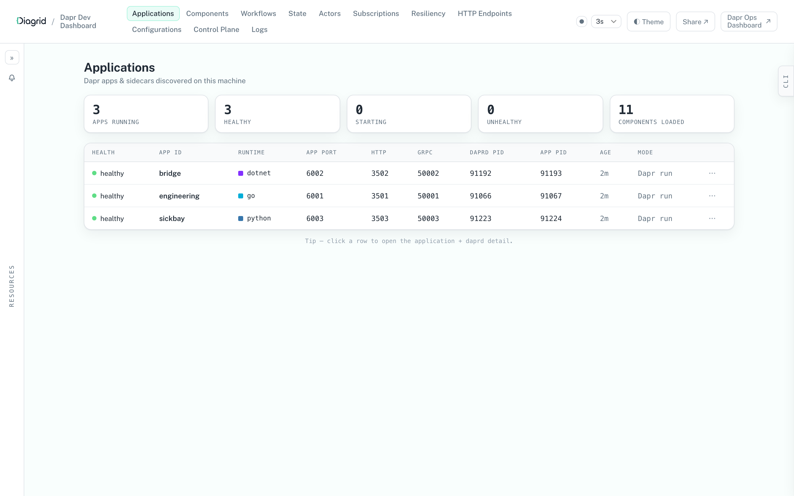
</picture>

<picture>
  <source media="(prefers-color-scheme: dark)" srcset="docs/images/workflow-overview-dark.png">
  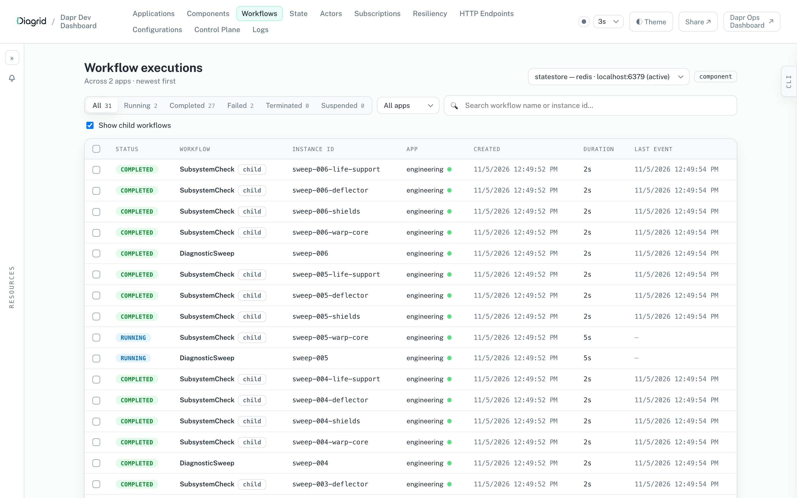
</picture>

## Goal

The Diagrid Dapr Dev Dashboard is a companion for local Dapr development. It inspects the
apps you start with `dapr run` / `dapr run -f`, Aspire, Docker Compose, or Dapr
Testcontainers (e.g. Spring Boot apps run with `mvn spring-boot:test-run` and
`dapr-spring-boot-starter-test`), and surfaces everything about them — sidecars, workflows,
actors, subscriptions, components, resiliency policies, HTTP endpoints, configurations, and
logs.

It also helps you author Dapr resources. The **Component Builder** walks you through
picking a component type from the full Dapr catalog, filling in its metadata fields, and
choosing an authentication profile; the **Resiliency Builder** composes resiliency policies
(timeouts, retries, circuit breakers) and applies them to targets (apps, actors, components).
Both wizards end in a YAML preview you can copy or download into your project.

## Installation instructions

The dashboard ships as a standalone binary published on GitHub Releases.

**Install (one-liner):**

*macOS / Linux — installs to ~/.local/bin*

```sh
curl -sSL https://raw.githubusercontent.com/diagridio/dev-dashboard/main/scripts/install.sh | sh
```

*Windows (PowerShell) — installs to %LOCALAPPDATA%\Programs\diagrid-dev-dashboard*

```powershell
iwr -useb https://raw.githubusercontent.com/diagridio/dev-dashboard/main/scripts/install.ps1 | iex
```

**To pin a specific version, set `VERSION` before piping:**

*macOS / Linux*

```sh
curl -sSL https://raw.githubusercontent.com/diagridio/dev-dashboard/main/scripts/install.sh | VERSION=vX.Y.Z sh
```

*Windows*

```powershell
$env:VERSION='vX.Y.Z'; iwr -useb https://raw.githubusercontent.com/diagridio/dev-dashboard/main/scripts/install.ps1 | iex
```

If the install directory is not on your `PATH`, the script prints the export line to add.

**Install with Go (≥ 1.26):**

```sh
go install github.com/diagridio/dev-dashboard@latest
```

> **Note:** `go install` names the binary after the module path, so it produces
> `dev-dashboard`, not `diagrid-dev-dashboard` — rename it afterwards
> (`mv "$(go env GOPATH)/bin/dev-dashboard" "$(go env GOPATH)/bin/diagrid-dev-dashboard"`)
> or use the install script above.

**Manual download:**

Download the archive for your platform from the [GitHub Releases](https://github.com/diagridio/dev-dashboard/releases) page, extract it, and place `diagrid-dev-dashboard` (or `diagrid-dev-dashboard.exe`) on your `PATH`. Verify with:

```sh
diagrid-dev-dashboard --version
```

## Run the dashboard

```sh
# Start on the default port (9090) and open your browser automatically
diagrid-dev-dashboard
```

```sh
# Start on a custom port
diagrid-dev-dashboard --port 8080
```

```sh
# Enable diagnostic logging to stderr (server startup, app discovery, state-store connection, log streams, workflow operations)
diagrid-dev-dashboard --verbose
```

No additional setup is needed: the dashboard discovers running Dapr apps the same way
`dapr list` does, so anything started with `dapr run` / `dapr run -f`, Aspire, Docker
Compose, or Dapr Testcontainers shows up within one refresh cycle. Testcontainers apps
(e.g. a Spring Boot app under `mvn spring-boot:test-run`) need zero configuration: the
dashboard finds the Testcontainers-managed daprd container, pairs it with your host app
process, and even reads workflows from an in-memory state store via the sidecar itself.

> **Tip:** once the dashboard is open, try the Konami code (↑ ↑ ↓ ↓ ← → ← → B A) and have
> some fun! ;)

With `--mode`/`DEVDASHBOARD_MODE` unset (the default for host use), the dashboard performs the
complete scan across all discovery sources described above. Setting a mode restricts every
dashboard surface — applications, workflows, state stores, the Control Plane view, and log
targets — to a single source; filters are exclusive and never combined:

- `--mode dapr-run` — host `dapr run` processes only (Control Plane shows the `dapr init` containers).
- `--mode compose` — Docker Compose containers only (Control Plane shows compose-run placement/scheduler), or a service inside your compose project when the `DEVDASHBOARD_APP_*` contract is set and the dashboard runs in a container.
- `--mode test-containers` — Testcontainers discovery only (no control-plane detection yet).
- `--mode aspire` — Aspire resources only. Inside an AppHost-managed container (the
  `DEVDASHBOARD_APP_*` contract is present) this is the container serving posture described
  below; on a plain host it filters the process scan to Aspire-managed apps.

`compose` and `test-containers` require a container runtime (docker or podman) and fail at
startup without one, except in container posture (the `DEVDASHBOARD_APP_*` contract is set
under `aspire` or `compose`), which needs no runtime. `--bind` (default `127.0.0.1`, `0.0.0.0`
in container posture) controls the listen address alongside `--port`.

## Run as a container

The dashboard also ships as a container image that runs inside an orchestrated project: either
a [.NET Aspire](https://learn.microsoft.com/dotnet/aspire/) AppHost, via the
[`diagrid-labs/dashboard-aspire`](https://github.com/diagrid-labs/dashboard-aspire) hosting
integration (which will be rewritten against the contract below), or a Docker Compose project.
It also runs standalone with a hand-written `docker run`. Both use the same env contract and
the same container posture; the differences are called out per subsection.

### Inside a .NET Aspire AppHost

**Image:** `ghcr.io/diagridio/dev-dashboard`, tagged `:X.Y.Z` (in lockstep with binary
releases) and `:latest`. Prerelease tags (e.g. `v1.5.0-rc.1`) publish their own version tag
but do not move `:latest`. The image bakes in `DEVDASHBOARD_MODE=aspire` and serves on port
`8080` bound to `0.0.0.0`.

In aspire mode, discovery is restricted to the env contract below (no host process scan, no
Docker Compose scan), and the following are disabled: app lifecycle controls
(start/stop/restart), the control-plane page, log tailing, self-update/update-check, and
automatic browser opening.

**Try it:**

```bash
docker run --rm -p 8080:8080 \
  -e DEVDASHBOARD_APP_COUNT=1 \
  -e DEVDASHBOARD_APP_0_ID=myapp \
  -e DEVDASHBOARD_APP_0_DAPR_HTTP=http://host.docker.internal:3500 \
  ghcr.io/diagridio/dev-dashboard:latest
```

**Mode switch:**

| Source | Values | Default |
|---|---|---|
| `--mode` flag / `DEVDASHBOARD_MODE` env | `dapr-run`, `compose`, `test-containers`, `aspire` | unset (complete scan) |

**App discovery** — one set of `_<i>_*` vars per app, for `i = 0..DEVDASHBOARD_APP_COUNT-1`:

| Env var | Required | Meaning |
|---|---|---|
| `DEVDASHBOARD_APP_COUNT` | yes | number of apps (`0` is valid: empty dashboard) |
| `DEVDASHBOARD_APP_<i>_ID` | yes | Dapr app-id |
| `DEVDASHBOARD_APP_<i>_DAPR_HTTP` | yes | daprd HTTP base URL, reachable **from the dashboard container** (e.g. `http://myapp-dapr:3500`) |
| `DEVDASHBOARD_APP_<i>_NAMESPACE` | no | per-app Dapr namespace; defaults to `DEVDASHBOARD_NAMESPACE`. Used for **app-scoped** workflow operations — fetching one instance's history, an app-filtered workflow list/stats, and force delete — so those honor the app's own namespace. The store-wide workflow list, stats, and app-id dropdown (all-apps scans) still use the global `DEVDASHBOARD_NAMESPACE` |
| `DEVDASHBOARD_APP_<i>_LABEL` | no | display name; defaults to the app-id. Shown in the applications list and app detail header whenever it differs from the app-id |
| `DEVDASHBOARD_APP_<i>_DAPR_GRPC` | no | daprd gRPC endpoint as `host:port`, reachable from the dashboard container. Only used by compose mode, to read workflows from the sidecar (Dapr 1.17+). Defaults to the host of `DAPR_HTTP` on port `50001` (e.g. `http://myapp-dapr:3500` becomes `myapp-dapr:50001`); set it when the sidecar runs with a non-default `-dapr-grpc-port` |

Validation is fail-fast at startup: a missing or non-numeric `DEVDASHBOARD_APP_COUNT`, any
missing required per-app var, an unparsable `DAPR_HTTP` URL, or a malformed `DAPR_GRPC`
`host:port` exits with an error naming the exact variable.

**Security note:** in aspire mode the dashboard drops the loopback `Host` check (the container
is addressed by its Docker-network name or a published port). Without `DEVDASHBOARD_ALLOWED_HOSTS`
it accepts any `Host`, which means a malicious web page using DNS rebinding can reach the API even
when the port is published only to `localhost`. Setting `DEVDASHBOARD_ALLOWED_HOSTS` to the
hostnames the dashboard is served under closes that hole (loopback names are always allowed).
Mutating requests are still protected by a normalized same-origin check. The dashboard is a local
development tool — never expose it publicly.

**Serving and features:**

| Env var / flag | Default (container posture) | Meaning |
|---|---|---|
| `DEVDASHBOARD_PORT` / `--port` | `8080` | listen port |
| `DEVDASHBOARD_BIND` / `--bind` | `0.0.0.0` | bind address |
| `DEVDASHBOARD_STATESTORE_FILE` / `--statestore` | unset | path to a mounted Dapr state-store component YAML; enables the State page and store-backed workflows; in compose container posture Workflows also works without it via the sidecars |
| `DEVDASHBOARD_NAMESPACE` / `--namespace` | `default` | default Dapr namespace for workflow actor keys |
| `DEVDASHBOARD_RESOURCES_PATH` | dir of `DEVDASHBOARD_STATESTORE_FILE` | extra resource directories for the Components, Configurations, Resiliency and HTTP Endpoints pages, `os.PathListSeparator`-separated |
| `DEVDASHBOARD_ALLOWED_HOSTS` | unset (any host) | optional, container posture only; comma-separated hostnames the `Host` header is restricted to (loopback always allowed). Empty means any host. Set it to close the DNS-rebinding hole described above |
| `DEVDASHBOARD_MODE` | `aspire` (baked into the image) | see mode switch above |
| `DEVDASHBOARD_IN_CONTAINER` | `true` (baked into the image) | marks the process as running in a container; compose container posture requires it (or Docker's `/.dockerenv` / Podman's `/run/.containerenv`). Set it yourself only for a runtime that leaves neither marker |

Precedence everywhere is **flag > env > posture default**.

### As a Docker Compose service

Add the dashboard as one more service in the same compose file as your Dapr apps. Set
`DEVDASHBOARD_MODE: compose` explicitly: the image bakes in `DEVDASHBOARD_MODE=aspire`, so
without the override the contract runs in aspire mode and the dashboard cannot read workflows
from the sidecars. With the contract present, `compose` selects the container posture above
(port `8080`, bound to `0.0.0.0`, no container runtime or docker socket needed). Without the
contract, `--mode compose` keeps its host behavior of scanning compose containers through
docker, and so does a host run where `DEVDASHBOARD_APP_*` happens to be set: compose
container posture also requires running in a container, so a variable left exported in your
shell can't switch it on. The startup banner says which posture was chosen and how many apps
the contract declares; in aspire container posture it also reminds you to set
`DEVDASHBOARD_MODE=compose` inside a compose project.

```yaml
services:
  order-processor:
    build: ./order-processor

  order-processor-dapr:
    image: daprio/daprd:1.19.1
    command:
      - "./daprd"
      - "-app-id"
      - &order_id order-processor
      - "-app-port"
      - "5001"
      - "-dapr-http-port"
      - "3500"
      - "-resources-path"
      - "/components"
    volumes:
      - "./components:/components:ro"
    network_mode: "service:order-processor"

  dev-dashboard:
    image: ghcr.io/diagridio/dev-dashboard:latest
    ports:
      - "9090:8080"
    environment:
      DEVDASHBOARD_MODE: compose
      DEVDASHBOARD_APP_COUNT: "1"
      DEVDASHBOARD_APP_0_ID: *order_id
      # order-processor owns the network namespace, so the sidecar is
      # addressed by the app's service name.
      DEVDASHBOARD_APP_0_DAPR_HTTP: http://order-processor:3500
      DEVDASHBOARD_RESOURCES_PATH: /components
    volumes:
      - "./components:/components:ro"
```

The YAML anchor (`&order_id` / `*order_id`) keeps the app-id from being declared twice. The
dashboard has no `depends_on`: discovery is static env parsing and sidecar health is probed on
every refresh, so apps simply show as unreachable until they come up.

**Addressing the sidecar.** `DEVDASHBOARD_APP_<i>_DAPR_HTTP` must point at whichever service
owns the sidecar's network namespace, not at a naming convention:

| Compose shape | `_DAPR_HTTP` value |
|---|---|
| App and sidecar as separate services | `http://<sidecar-service>:3500` |
| App joins the sidecar (`network_mode: "service:daprd"`) | `http://daprd:3500` (the sidecar owns the namespace) |
| Sidecar joins the app (`network_mode: "service:app"`) | `http://app:3500` (the **app** service name; the sidecar is not resolvable by name) |

The same rule applies to `_DAPR_GRPC` when you set it explicitly; when you omit it, the
derived default reuses the host of `_DAPR_HTTP`, so it follows the same shape.

**What is off, and why.** As in aspire mode, discovery is restricted to the env contract, and
these are disabled: app lifecycle controls (start/stop/restart), the control-plane page, log
tailing, self-update/update-check, automatic browser opening, and secret-value reveal.

- Lifecycle and the control-plane page need a container runtime to start, stop, and inspect
  containers; the dashboard runs without the docker socket.
- Logs are architecturally unavailable, not unimplemented: `docker logs` needs the socket,
  daprd exposes no log API, and daprd logs to stdout rather than a file a shared volume could
  carry.
- Update-check and self-update are off because container images are updated by tag, not in place.
- Secret-value reveal is always off when the dashboard is served off-host. The component view
  still shows the *status* of secret references.
- Placement connectivity is still visible on App Detail and Actors, since it comes from the
  sidecar's metadata.
- Workflows works without a state store: the dashboard reads them through each declared
  sidecar's gRPC endpoint (Dapr 1.17+; older runtimes report that the sidecar does not
  support workflow inspection). If `DEVDASHBOARD_STATESTORE_FILE` also points at a mounted
  store, both sources are merged and the sidecar wins on collisions; an app whose sidecar is
  unreachable or older than 1.17 is served from the store instead.
- The State page appears only when `DEVDASHBOARD_STATESTORE_FILE` points at a mounted
  state-store component. Mounting components via `DEVDASHBOARD_RESOURCES_PATH` alone feeds the
  Components, Configurations, Resiliency and HTTP Endpoints pages but does not enable State.
- State-store connections can't be saved. There is no connection registry inside the
  container, so the store from `DEVDASHBOARD_STATESTORE_FILE` is listed read-only, "Add
  connection" is hidden, and the connections API answers `409`.
- App status comes only from what the compose network can show. If daprd reports an app port,
  the dashboard probes it; otherwise the app counts as running while it has a workflow worker
  connected to its sidecar. With neither signal, App Detail shows the app status as "not
  observable" and the Applications list marks the row with ⓘ: the health shown there is the
  sidecar's. App Detail shows the sidecar's HTTP and gRPC addresses in place of ports, PIDs
  and paths, which don't exist in this mode.

**Troubleshooting.**

1. **Sidecar shows as unreachable, or metadata probes fail with DNS errors.** If your compose
   file declares custom `networks`, the dashboard service must be attached to every network
   its target sidecars are on; the implicit default network works automatically. In compose
   container posture the app is still listed, marked unreachable, and recovers on the next
   refresh once the sidecar answers. The hint tells you to share a Docker network, not to
   publish a port: the list tooltip says "the dashboard and this app must share a Docker
   network", and App Detail says to make sure the dashboard and the app's sidecar are on the
   same Docker network and that `DEVDASHBOARD_APP_*_DAPR_HTTP` uses the service name that owns
   the network namespace.
2. **Connection refused on a name that resolves.** Check the addressing table above: with
   `network_mode: "service:..."` the sidecar is only reachable by the namespace owner's
   service name.
3. **Workflows page reports the sidecar does not support workflow inspection.** Sidecar
   workflow reads need Dapr 1.17+. Upgrade daprd, or mount the state store via
   `DEVDASHBOARD_STATESTORE_FILE` so that app's workflows are read from the store.
4. **A workflow's detail says "the Dapr sidecar of app … is unreachable".** That app's sidecar
   is stopped or can't be reached, and no store is mounted to read its history from instead.
   The workflow list skips unreachable sidecars, so the other apps' workflows still load
   promptly. Start the sidecar, or mount the store via `DEVDASHBOARD_STATESTORE_FILE`.

## Updating the dashboard

On startup the dashboard checks GitHub for a newer release. If one exists, it prints
a notice as the first line of output and the web UI shows an **Update available**
indicator next to the version number in the Resources panel. The check is best-effort:
it is skipped for source/dev builds and fails silently when offline.

Update to the latest release (no-op if already current)

```sh
diagrid-dev-dashboard update
```

Install a specific version (can downgrade or reinstall)

```sh
diagrid-dev-dashboard update 1.2.0
```

`update` downloads the release archive for your platform, verifies its SHA256
against the release `checksums.txt`, and atomically replaces the running binary.
Restart any running dashboard to use the new version.

## Troubleshooting

If the dashboard does not behave as expected, run it with `--verbose` to print diagnostic logs to stderr:

```sh
diagrid-dev-dashboard --verbose
```

Logs are grouped by `component=` (values: `server`, `discovery`, `workflow`, `registry`, `reconciler`) and use levels INFO (normal milestones), WARN (degraded but still working, e.g. a state store that failed to initialise), and ERROR (an operation failed, e.g. the server could not bind its port). Without `--verbose`, no diagnostic logs are emitted.

## Use cases

Developers use the dashboard to observe and debug Dapr apps while building locally:

- **See what's running** — a live table of all running apps/sidecars: app id, health,
  runtime/language, app/HTTP/gRPC ports, daprd + app PIDs, age, and owning run process.
  Apps that have fully stopped can be removed from the list one by one or all at once with
  **Clear inactive**. This only hides them from the dashboard; no containers or files are
  deleted, and an app that starts running again reappears.
- **Inspect an application** — drill into a single app for its ports, PIDs, command,
  resource/config paths, runtime metadata, enabled features, and loaded components and HTTP
  endpoints. Stop
  works for every discovery mode; Start and Restart are offered for Docker Compose apps only.
- **Debug workflows** — browse workflow executions across all apps with status filters and
  search, then open a run to watch its **live event history**, input/output, custom status,
  and a continuously-ticking wall-clock while it runs. Payloads that a Dapr 1.19 SDK moved to a
  binary store (a `$daprRef` data reference) show as a card; **Load payload** fetches the value
  through the app's sidecar (up to 1 MiB) and checks its sha256.
- **Clean up workflows** — terminate and/or purge individual or bulk workflows, with an
  explicit "force delete" fallback for stuck/orphaned state.
- **Browse, add & clean state records** — the **State** page lists the records in any connected
  state store: key, app prefix, value preview, size, version (etag), and TTL, paginated over the
  backend's own key cursor, with row expansion for the full value and a *Decode base64* toggle for
  encoded values. **+ New record** writes a record under `<app-id>||<key>` — the same key shape
  Dapr writes — and refuses a key that already exists unless you opt into overwriting; records can
  be deleted individually or by multi-select. There is no in-place edit: overwrite the key instead.
  Two limitations worth knowing:
  **workflow history and actor state are hidden by default** (they live in the same keyspace
  as your app's records — use *Show internal keys* to reveal them), and **there is no
  "last modified" column** — Dapr's state components do not expose a modification timestamp,
  so none can be shown. The Version column is the backend's etag: it changes on every write,
  but it is not a time. Stores that cannot be opened directly — an in-memory store inside a
  Testcontainers app, for example — cannot be browsed at all: Dapr's state API has no way to
  enumerate keys, so there is nothing to page over.
- **Review actors & subscriptions** — global pages aggregating active actor types and pub/sub
  subscriptions across all apps, each linkable back to the owning application. The
  Subscriptions page shows each subscription's type (declarative, programmatic, streaming) and
  expands multi-rule subscriptions to show every match expression and its route.
- **Publish a test message** — every subscription row has a **Publish** button that sends a
  real message to its pub/sub topic through the app's sidecar, with a payload editor, a
  content-type selector, and advanced options (`ttlInSeconds`, `rawPayload`).
- **Copy the matching Dapr CLI command** — a **CLI** drawer on the right edge of the page lists
  the self-hosted Dapr CLI commands that fit the current page, already filled in with the app
  ID and workflow instance ID you're looking at.
- **Read components & configurations** — read-only YAML viewers, enriched with which apps
  loaded each component; components that only exist inside a Testcontainers daprd container
  are extracted and shown too, with a container-prefixed path. A component's `secretKeyRef`
  and `envRef` values are resolved against your local secret stores (`local.file`,
  `local.env`), and each reference shows whether it resolved, and if not, which env var or
  file path was tried. Each configuration shows which apps use it, matched on the file the
  app's sidecar was started with (`--config`, or a run template's `configFilePath`).
- **Review resiliency policies & HTTP endpoints** — the **Resiliency** page lists discovered
  `Resiliency` files with their scopes, policies, targets, and the apps that loaded them. The
  **HTTP Endpoints** page does the same for `HTTPEndpoint` resources (non-Dapr services called
  through `/v1.0/invoke`): base URL, scopes, headers, and loaded-by apps. Headers that use
  `secretKeyRef` or `envRef` show whether the reference resolves, never the value, and plain
  values that look like credentials are masked until you click **Show**.
- **Build component YAML** — a guided wizard over the full Dapr component catalog: pick a
  type, fill in its metadata fields (with per-field docs and defaults), choose an
  authentication profile, then copy or download the generated YAML.
- **Build resiliency policies** — compose named timeouts, retries, and circuit breakers,
  apply them to targets (apps, actors, components), and export the resiliency spec as YAML.
- **Manage workflow state-store connections** — on the Components page, a recent-connections panel
  (with component file paths) lets you add, edit, and disconnect the state stores the dashboard
  reads workflows from. Auto-detected stores appear automatically; disconnecting one is durable —
  it stays hidden across restarts unless it becomes the active store again. The store workflows
  are currently read from can't be removed. Manual connections are saved to
  `~/.dapr/dev-dashboard/connections.yaml` (mode `0600`). When more than one store is known, a
  selector on the Workflows page lets you switch which one you browse.
- **Tail logs** — per-app daprd + app logs streamed live (SSE) with level coloring, keyword
  highlight, and a follow toggle.

The UI is built for fast scanning and debugging: deep-linkable views, a global autorefresh
control that doubles as a backend-connection indicator (data polling pauses while the
backend is unreachable and resumes on recovery), full keyboard operability, and
cross-navigation between related entities (app →
component → "loaded by" app, etc.).

# Pages

The sections below follow the order of the menu, from left to right.

## Applications

The **Applications** page lists every running app and sidecar: app ID, health, runtime, ports, PIDs, age and the run process that owns it. Apps that have fully stopped can be removed from the list one at a time or all at once with **Clear inactive**.

<picture>
  <source media="(prefers-color-scheme: dark)" srcset="docs/images/applications-dark.png">
  
</picture>

Open an app to see its ports, PIDs, command, resource and config paths, runtime metadata, enabled features, and the components and HTTP endpoints its sidecar loaded. Stop works in every discovery mode; Start and Restart are offered for Docker Compose apps only.

<picture>
  <source media="(prefers-color-scheme: dark)" srcset="docs/images/application-detail-dark.png">
  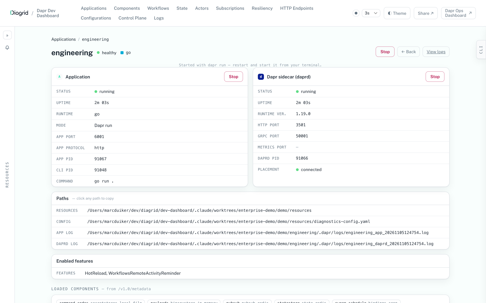
</picture>

## Components

The **Components** page lists the discovered components with their type and the apps that loaded them. On the same page you manage the state-store connections the dashboard reads workflows from.

<picture>
  <source media="(prefers-color-scheme: dark)" srcset="docs/images/components-dark.png">
  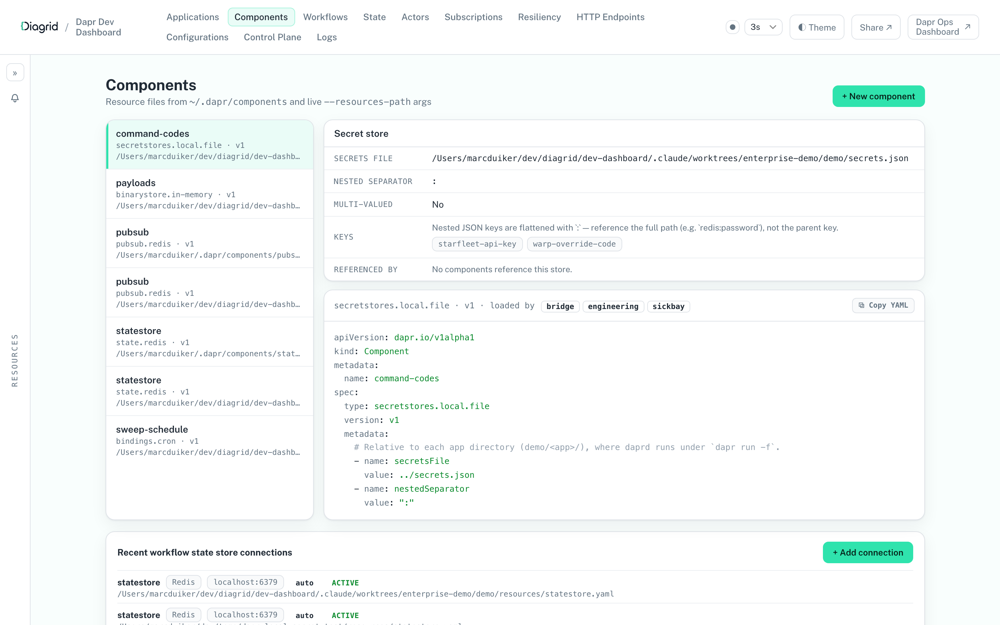
</picture>

Each component shows its YAML and the apps that loaded it. `secretKeyRef` and `envRef` values are resolved against your local secret stores, and each reference shows whether it resolved.

<picture>
  <source media="(prefers-color-scheme: dark)" srcset="docs/images/component-detail-dark.png">
  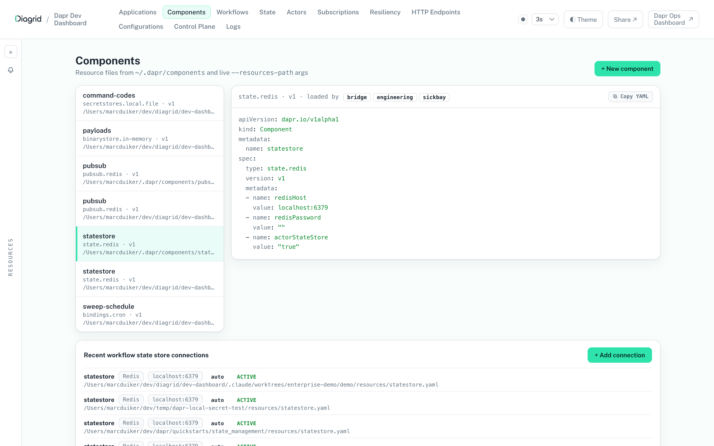
</picture>

The **Component Builder** walks you through the full Dapr component catalog: pick a type, fill in its metadata fields and choose an authentication profile. The wizard ends in a YAML preview you can copy or download.

<picture>
  <source media="(prefers-color-scheme: dark)" srcset="docs/images/component-builder-dark.png">
  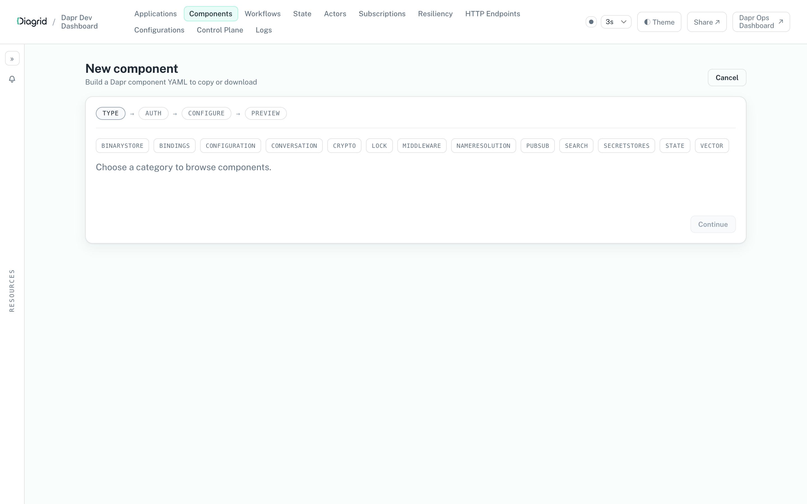
</picture>

## Workflows

The **Workflows** page lists workflow runs across all apps, with status filters and search. Runs can be terminated and purged one at a time or in bulk.

<picture>
  <source media="(prefers-color-scheme: dark)" srcset="docs/images/workflow-overview-dark.png">
  
</picture>

A workflow run shows its live event history, input, output and custom status. When a run fails, a banner at the top shows the error, and the event that failed shows its error details inline.

<picture>
  <source media="(prefers-color-scheme: dark)" srcset="docs/images/workflow-detail-dark.png">
  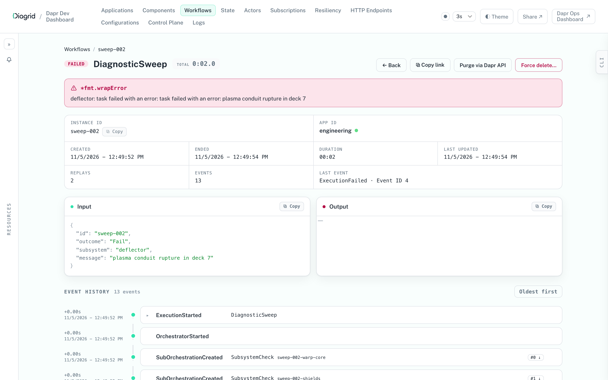
</picture>

A payload that a Dapr 1.19 SDK moved to a binary store shows as a `$daprRef` card with its store, key and size. **Load payload** fetches the value through the app's sidecar and checks its sha256.

<picture>
  <source media="(prefers-color-scheme: dark)" srcset="docs/images/workflow-dataref-dark.png">
  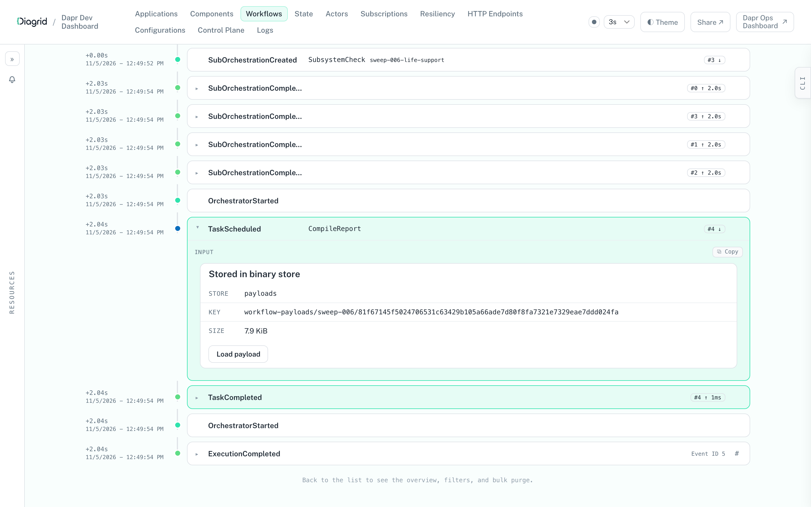
</picture>

## State

The **State** page lists the key/value records in a connected state store, with the key, app prefix, value preview, size, version and TTL. Workflow and actor state is hidden unless you tick *Show internal keys*.

<picture>
  <source media="(prefers-color-scheme: dark)" srcset="docs/images/state-dark.png">
  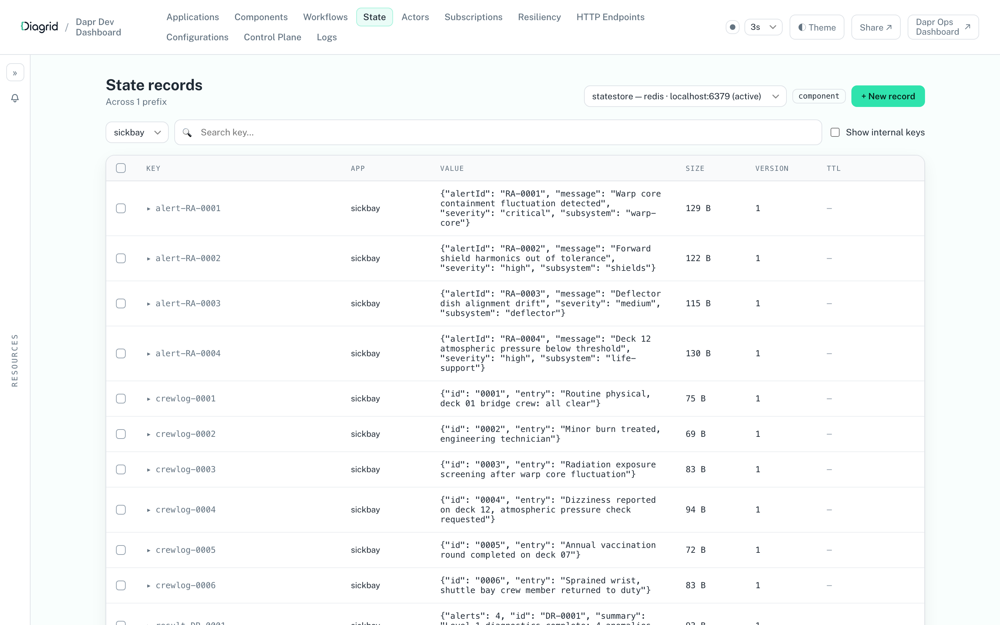
</picture>

Expand a row to see the full value with its size, version and encoding. **+ New record** adds a record, and records can be deleted one at a time or by multi-select.

<picture>
  <source media="(prefers-color-scheme: dark)" srcset="docs/images/state-records-dark.png">
  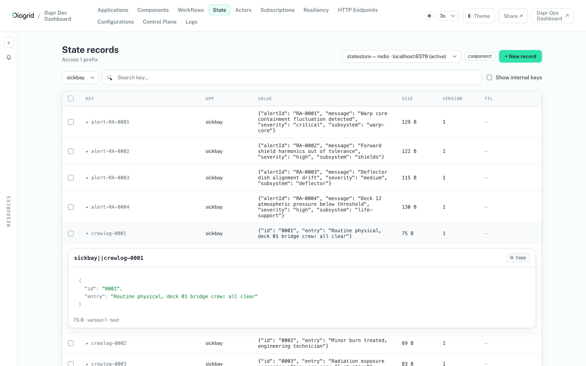
</picture>

## Actors

The **Actors** page lists the actor types across all apps: the host app, the number of active actors, the idle timeout, reminders and placement status.

<picture>
  <source media="(prefers-color-scheme: dark)" srcset="docs/images/actors-dark.png">
  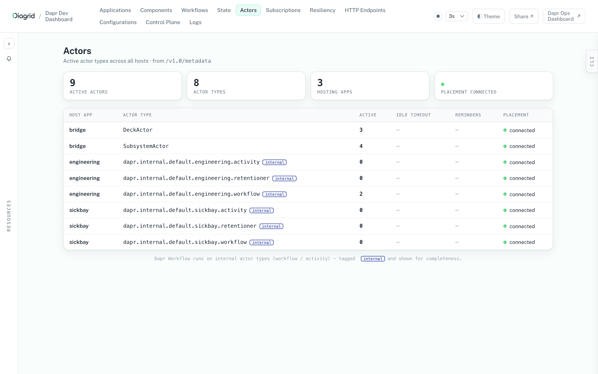
</picture>

## Subscriptions

The **Subscriptions** page lists the pub/sub subscriptions across all apps, with their type (declarative, programmatic or streaming), topic and routes. Subscriptions with several rules expand to show every match expression.

<picture>
  <source media="(prefers-color-scheme: dark)" srcset="docs/images/subscriptions-dark.png">
  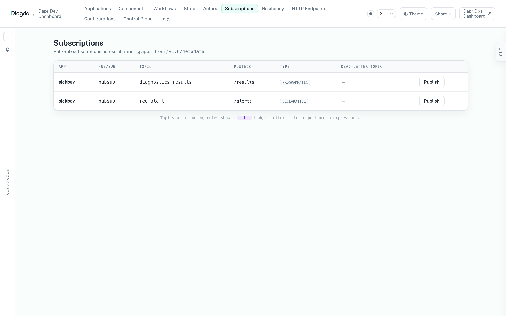
</picture>

**Publish** opens a dialog that sends a message to that subscription's pub/sub component and topic. Enter the payload, pick a content type, and optionally set `ttlInSeconds` or `rawPayload` under *Show advanced*. The message goes through the app's sidecar to the real broker, so the subscriber receives it like any other message.

<picture>
  <source media="(prefers-color-scheme: dark)" srcset="docs/images/publish-message-dark.png">
  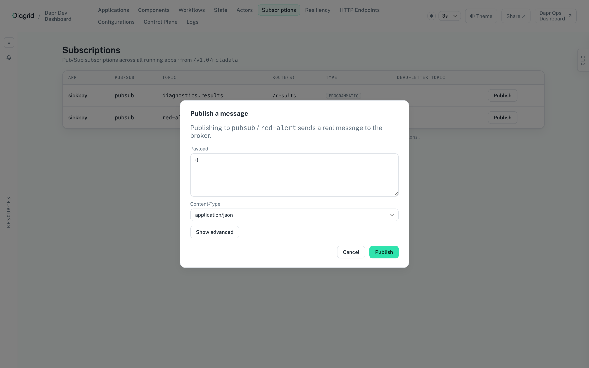
</picture>

## Resiliency

The **Resiliency** page lists the discovered `Resiliency` files with their scopes, policies, targets and the apps that loaded them.

<picture>
  <source media="(prefers-color-scheme: dark)" srcset="docs/images/resiliency-dark.png">
  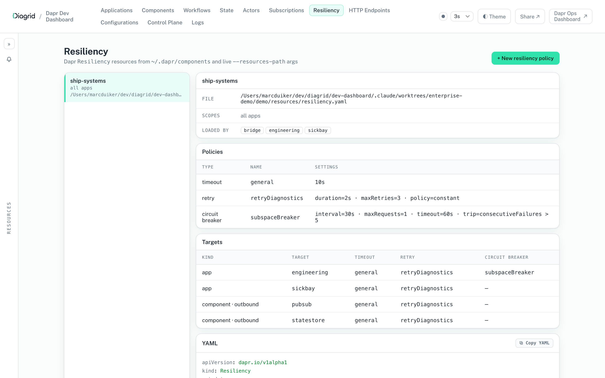
</picture>

The **Resiliency Builder** lets you compose named timeouts, retries and circuit breakers, apply them to apps, actors and components, and export the resiliency spec as YAML.

<picture>
  <source media="(prefers-color-scheme: dark)" srcset="docs/images/resiliency-builder-dark.png">
  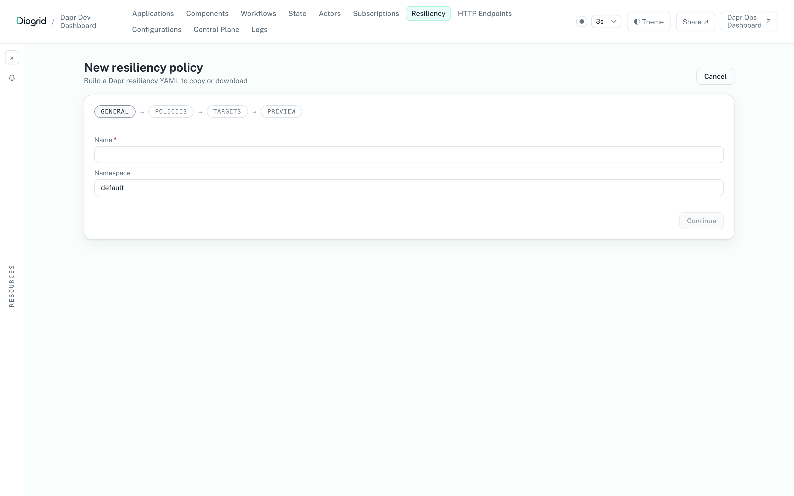
</picture>

## HTTP Endpoints

The **HTTP Endpoints** page lists `HTTPEndpoint` resources with their base URL, scopes, headers and the apps that loaded them. Secret-backed headers show whether they resolve, never the value.

<picture>
  <source media="(prefers-color-scheme: dark)" srcset="docs/images/http-endpoints-dark.png">
  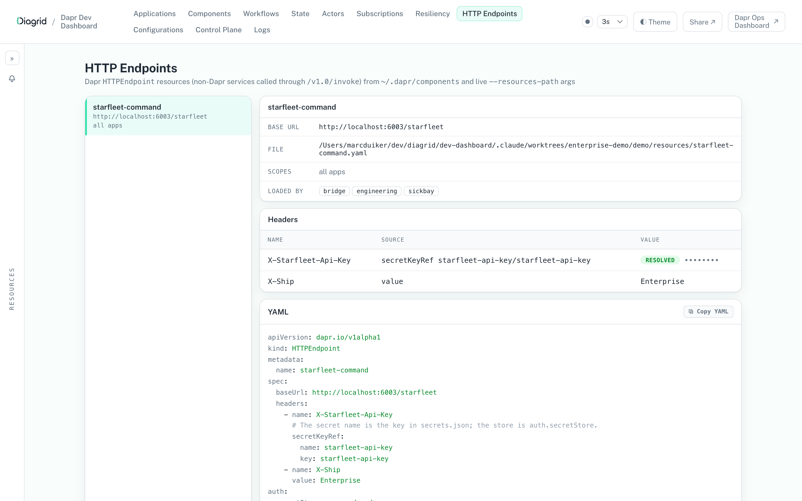
</picture>

## Configurations

The **Configurations** page shows each Dapr `Configuration` file as YAML, with the apps whose sidecar was started with it.

<picture>
  <source media="(prefers-color-scheme: dark)" srcset="docs/images/configurations-dark.png">
  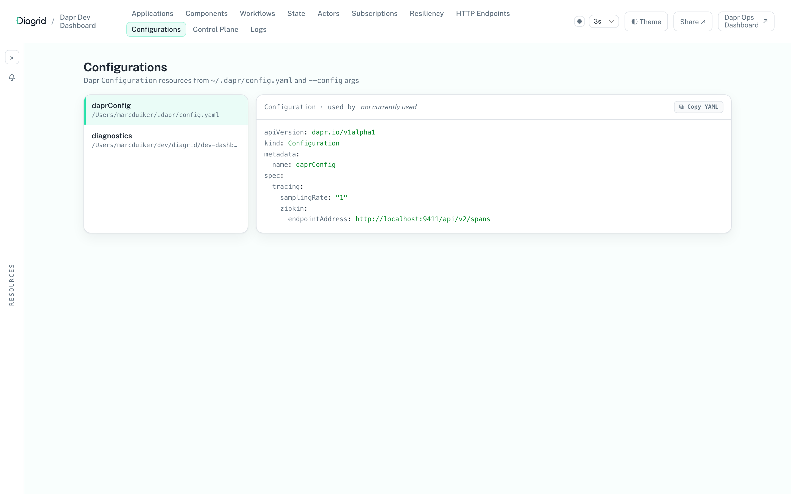
</picture>

## Control Plane

The **Control Plane** page shows the `dapr init` containers (placement, scheduler and the rest) with their status, and lets you start, restart or stop them.

<picture>
  <source media="(prefers-color-scheme: dark)" srcset="docs/images/control-plane-dark.png">
  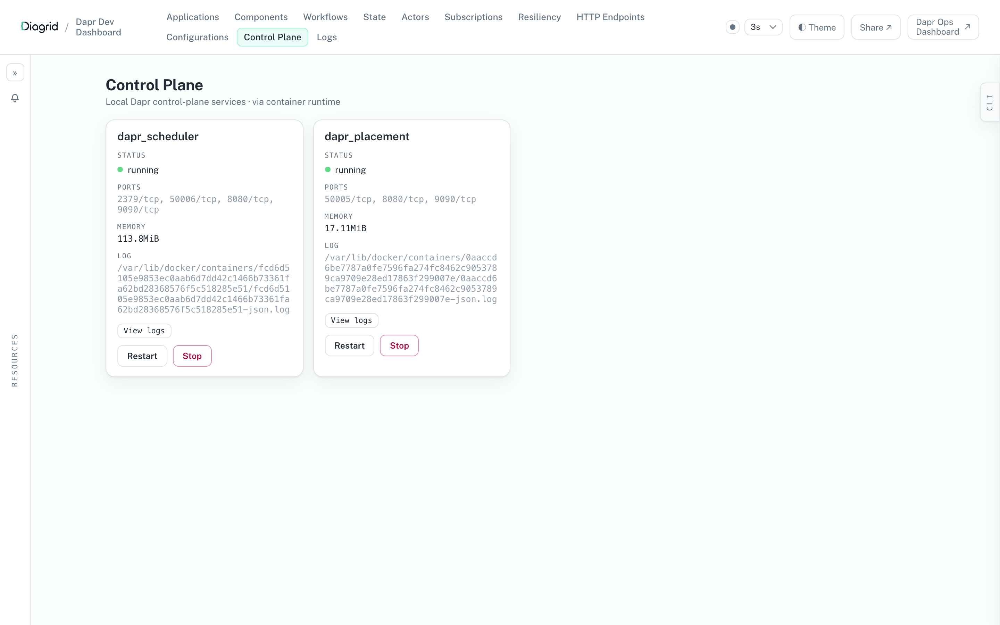
</picture>

## Logs

Stream an app's daprd or application logs live, with level coloring, keyword highlighting and a follow toggle.

<picture>
  <source media="(prefers-color-scheme: dark)" srcset="docs/images/logs-dark.png">
  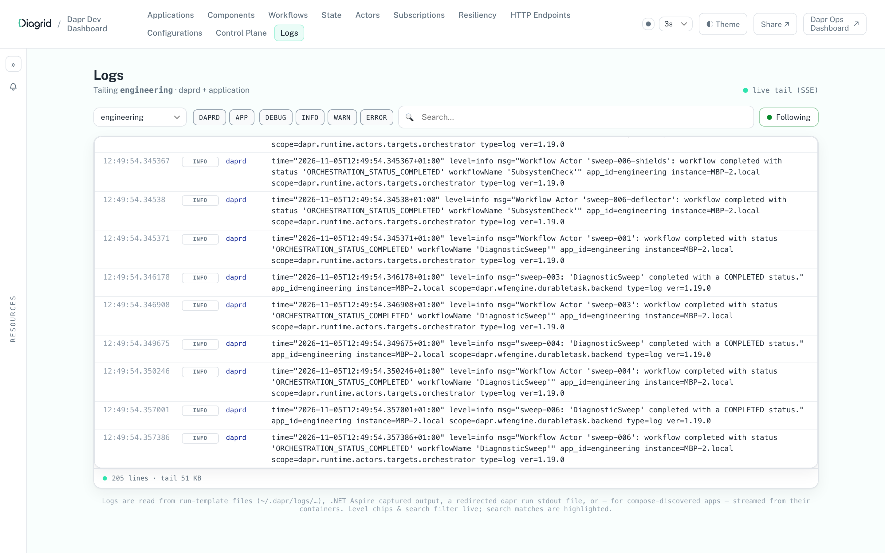
</picture>

## CLI drawer

The **CLI** tab on the right edge of the page isn't a menu item, but it's available on the Applications, Application detail, Workflows, Workflow detail, Actors and Subscriptions pages. It lists the self-hosted Dapr CLI commands for what you're looking at, already filled in with the app ID or workflow instance ID. On a workflow instance, for example, it lists the commands to view the history, raise an event, terminate, suspend, resume, re-run, or purge that instance. Each command has a link to its docs and a **Copy** button.

<picture>
  <source media="(prefers-color-scheme: dark)" srcset="docs/images/cli-drawer-dark.png">
  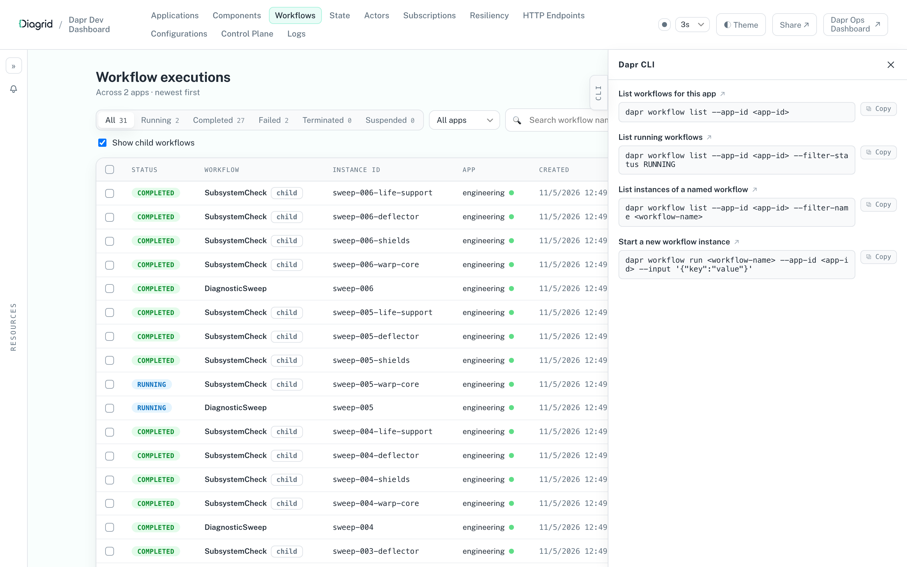
</picture>

## Non-Goals

The dashboard is a **local development tool**, and only that:

- **Not for Kubernetes.** It is not intended to run inside a Kubernetes cluster. It discovers
  apps the way `dapr list` does — from the local process table and local container runtime —
  which has no meaning in-cluster.
- **Not for production.** It is not intended for production, staging, or any shared/hosted
  environment. It has no authentication, authorization, or multi-user model, and it reads
  local files and state stores with the privileges of the user who runs it.
- **Not a control plane or deployment tool.** It observes and helps you author YAML locally;
  it does not deploy apps or manage remote Dapr installations.

Run it on your own machine, alongside the apps you start with `dapr run`, Aspire, Docker
Compose, or Dapr Testcontainers.

## Architecture

The dashboard is a **single Go binary** with an embedded React SPA. It discovers running
apps the same way `dapr list` does (plus Docker Compose, Testcontainers, and Aspire),
enriches them from each sidecar's `/v1.0/metadata` and `/v1.0/healthz` endpoints, and reads
workflows from your state store (Redis, PostgreSQL, SQLite, or MongoDB), or live from the
sidecar's gRPC workflow API (Dapr ≥ 1.17) when the store can't be opened.

See [ARCHITECTURE.md](ARCHITECTURE.md) for how discovery, state-store election, the HTTP
layer, and the SPA fit together, and where to extend each part. The original design
rationale is in
[`docs/specs/2026-06-25-dev-dashboard-design.md`](docs/specs/2026-06-25-dev-dashboard-design.md).

## Contributing

Contributions are welcome! See [CONTRIBUTING.md](CONTRIBUTING.md) for how to report issues,
build from source, run the tests and linters, submit pull requests, and cut a release. All commits must be signed off
per the [Developer Certificate of Origin](https://developercertificate.org/) (`git commit -s`).

## License

Copyright © Diagrid Inc. Licensed under the [Apache License 2.0](LICENSE).
